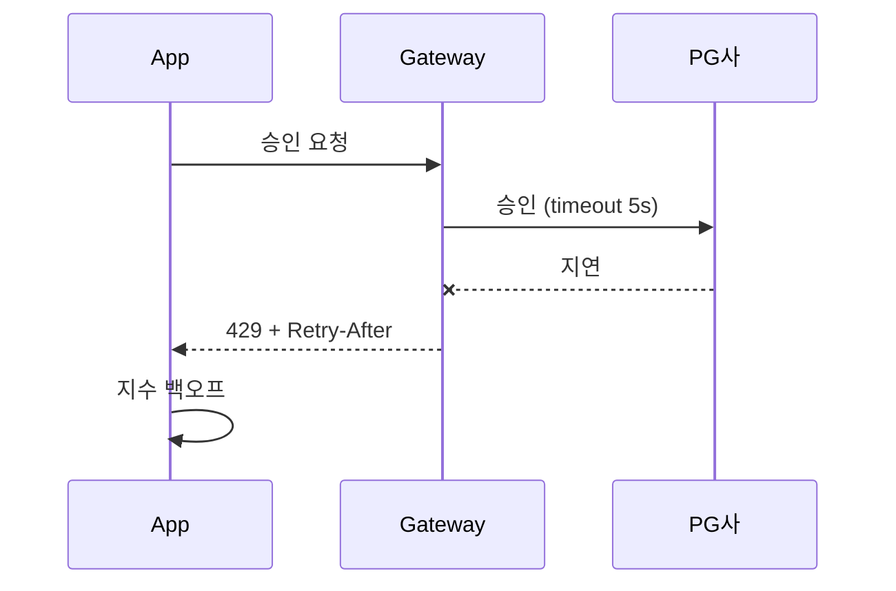

# 장애 회고 2026-11-05 (결제 승인 타임아웃)

영향: 14:02~14:37 (35분) 결제 승인 실패율 최대 38%. 원인 요약: **PG 응답 지연 → 커넥션 풀 고갈 → 재시도 폭주**. 후속: [[ADR-0007 레이트리밋 정책]]

## 타임라인
| 시각 | 사건 |
| --- | --- |
| 14:02 | PG사 응답 지연 시작(p99 4.8s) |
| 14:09 | 알림 발생 — 승인 API 에러율 12% |
| 14:15 | 앱이 실패 시 즉시 재시도 → 요청량 3배 |
| 14:24 | DB 커넥션 풀 100/100 포화 |
| 14:31 | 재시도 차단 핫픽스 배포 |
| 14:37 | 정상화 |

## 원인 분석
커넥션 점유 시간이 가장 긴 쿼리를 확인했다.

```sql
SELECT pid, now() - query_start AS running, state, left(query, 80) AS q
FROM pg_stat_activity
WHERE state <> 'idle'
ORDER BY running DESC
LIMIT 10;
```

장애 당시 로그 확인에 쓴 명령:

```bash
kubectl -n payments logs deploy/gateway --since=40m \
  | grep -E 'timeout|ECONNRESET' \
  | awk '{print $1}' | cut -c1-16 | sort | uniq -c
```

핫픽스(재시도 간격 제한) 변경점:

```diff
- const delay = 0
+ const delay = Math.min(30_000, 500 * 2 ** attempt) + jitter()
  await sleep(delay)
```

## 재발 방지


## 액션 아이템
- [ ] 승인 API 타임아웃/서킷브레이커 → 할 일에 등록됨
- [ ] 커넥션 풀 한도 점검 → 민혁
- [ ] 알림 임계치 조정(에러율 5%→3%) → 지수

#incident #postmortem
