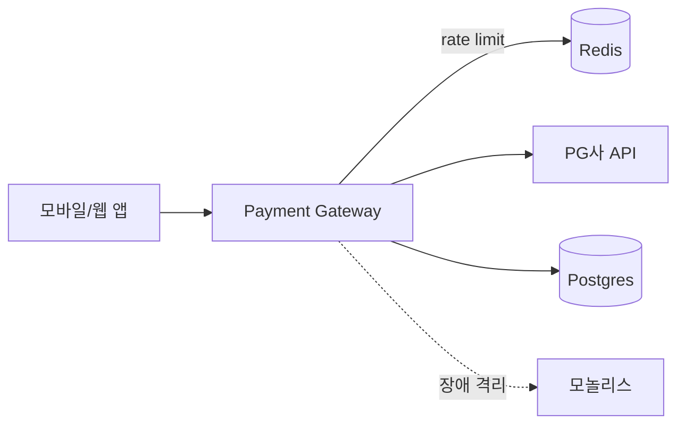

# 결제 게이트웨이 리팩터링

모놀리스 안에 있던 결제 승인 경로를 **독립 게이트웨이**로 분리한다. 목표는 승인 API p99 지연 800ms → 300ms, 장애 전파 차단.

## 목표 (Q4)
- [ ] 레이트리밋·서킷브레이커를 게이트웨이 계층으로 이동
- [ ] 승인 API p99 300ms 이하
- [ ] 장애 시 결제 외 기능(주문 조회 등)에 영향 없음

## 구조

## 관련 문서
- 결정 기록: [[ADR-0007 레이트리밋 정책]]
- 장애 회고: [[장애 회고 2026-11-05]]
- 스탠드업: [[회의록 2026-11-09 스탠드업]]
- 운영 메모: [[kubectl 치트시트]], [[SQL 슬로우쿼리 분석]]

## 일정
| 마일스톤 | 날짜 | 상태 |
| --- | --- | --- |
| 게이트웨이 스켈레톤 배포 | 2026-11-20 | 진행 중 |
| 트래픽 10% 카나리 | 2026-12-02 | 대기 |
| 전체 전환 | 2026-12-18 | 대기 |
